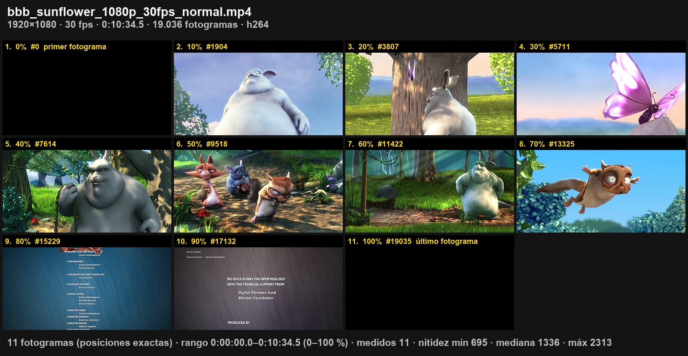
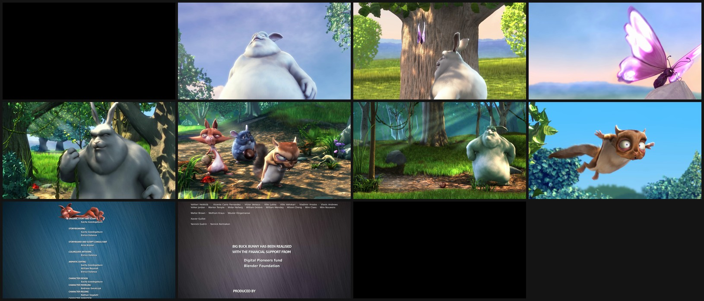
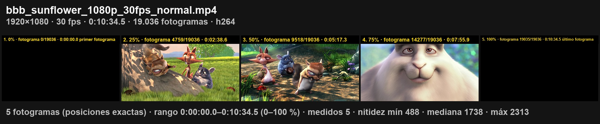

# storyboard-mcp

Servidor **MCP** (Model Context Protocol) que deja a un asistente como Claude **ver un vídeo**. Resume el vídeo en una **hoja de contactos** (una cuadrícula de fotogramas) y saca los fotogramas que quieras a tamaño completo. Para elegir los fotogramas puede:
- quedarse con los **más nítidos** de cada tramo;
- tomarlos **equiespaciados**;
- tomarlos en **posiciones exactas**, en segundos o en **porcentaje** de la duración. El servidor calcula esas posiciones a partir de la duración del vídeo.

- Va en un único archivo, [`server.py`](server.py). Se ejecuta con [`uv`](https://docs.astral.sh/uv/), que instala las dependencias solo.
- **No hace falta ffmpeg**: decodifica con [PyAV](https://pyav.org), que ya trae las librerías de FFmpeg. Para lo demás (por ejemplo, montar un vídeo con imágenes) el repositorio trae su propio [`bin/ffmpeg`](#ffmpeg-incluido-binffmpeg), compilado del código oficial.
- **Es rápido con películas largas**: en el modo de posiciones salta directamente a cada punto sin decodificar todo. Una hoja de 11 fotogramas de una película de 10,5 min en 1080p tarda unos 2,5 s.
- Licencia **MIT**.

### Ejemplo: un fotograma cada 10 % de la película (`step_pct: 10`)

Arriba, los datos del vídeo; abajo, lo que muestra la hoja (las mismas cifras que devuelve el JSON). El servidor calcula las 11 posiciones (0 %, 10 %… 100 %) con la duración. El 0 % es exactamente el **primer fotograma** (#0, 0,0 s) y el 100 % el **último** (#19035 de 19036, 634,5 s). Etiquetas: índice, % y nº de fotograma (`label_fields: ["index", "pct", "frame", "anchor"]`).



La misma hoja sin etiquetas (`label: false`, o las dos a la vez con `both_versions: true`):



Con una plantilla de etiqueta propia (`step_pct: 25`, `label_template: "{index}. {pct}% · fotograma {frame}/{frames_total} · {time_hms} {anchor}"`):



<sub>*Big Buck Bunny* © 2008 Blender Foundation, [peach.blender.org](https://peach.blender.org), licencia [CC BY 3.0](https://creativecommons.org/licenses/by/3.0/). Archivo `bbb_sunflower_1080p_30fps_normal.mp4` de [download.blender.org/demo/movies/BBB](https://download.blender.org/demo/movies/BBB/). El primer y el último fotograma de la película son negros.</sub>

---

## Cómo se usa (en 3 pasos)

Un **MCP** es un conjunto de herramientas que se conecta a un asistente (Claude Code, Claude Desktop u otro cliente compatible). Una vez instalado **no lo ejecutas tú**: le pides al asistente lo que quieres, en lenguaje normal, y él decide qué herramienta llamar y con qué parámetros.

**1. Instala `uv`** (una sola vez). Es lo que arranca el servidor y le instala sus dependencias:
```bash
curl -LsSf https://astral.sh/uv/install.sh | sh        # macOS / Linux
# Windows (PowerShell): powershell -c "irm https://astral.sh/uv/install.ps1 | iex"
```

**2. Descarga el servidor y conéctalo a tu asistente:**
```bash
git clone https://github.com/Eliaxs1900/storyboard-mcp.git
claude mcp add --scope user storyboard -- uv run --script "$PWD/storyboard-mcp/server.py"
```
Con `claude mcp list` deberías ver `storyboard: … ✔ Connected`. Para Claude Desktop y otros clientes, mira [Instalación](#instalación).

**3. Pídeselo al asistente**, indicando la ruta del vídeo:

> «Mira `~/Movies/viaje.mp4` y hazme una hoja con un fotograma cada 10 %, con índice, porcentaje y número de fotograma.»

El asistente:
1. llama a `video_info` para conocer la duración y los fotogramas;
2. llama a `video_contact_sheet` con `step_pct: 10` y `label_fields: ["index", "pct", "frame"]`;
3. abre la imagen generada y te describe lo que ve. Si necesitas más detalle, llama a `video_frames` para sacar fotogramas concretos a tamaño completo.

Otras peticiones que entiende:

| Le dices | Lo que hace |
|---|---|
| «Resume este vídeo del móvil, que no salgan fotos movidas» | 20 fotogramas, el más nítido de cada tramo, y descarta el 30 % más borroso (`min_sharpness_pct: 30`) |
| «Uno cada 30 segundos, sin etiquetas y con un poco de separación» | `step_s: 30`, `label: false`, `gap_px: 8` |
| «Solo del minuto 2 al 3, sin fotogramas repetidos» | `start_s: 120`, `end_s: 180`, `min_difference: 6` |
| «Hazme las dos versiones, con y sin etiquetas» | `both_versions: true` → `<nombre>_labels.jpg` y `<nombre>_sin_labels.jpg` |
| «Solo las imágenes, sin la cabecera ni el pie de datos» | `header: false`, `footer: false` |
| «Dame el primer, el del medio y el último fotograma en grande» | `video_frames` con `positions_pct: [0, 50, 100]` |
| «El fotograma del minuto 5, el más nítido de alrededor» | `video_frames` con `times_s: [300]`, `sharpest_within_s: 0.5` |

Las imágenes se guardan donde diga el asistente (o donde tú le indiques). La respuesta JSON de cada herramienta trae las rutas exactas y los datos de cada fotograma: número, tiempo, %, nitidez.

> **Sin asistente:** también puedes llamar a las funciones desde Python. Mira [Probar sin cliente MCP](#probar-sin-cliente-mcp).

---

## Por qué existe

Los modelos no pueden reproducir un vídeo: hay que enseñarles fotogramas. Si los fotogramas se cogen a ciegas, en un vídeo grabado a mano muchos salen **movidos**, y en un plano fijo salen **repetidos**. `storyboard-mcp` lo resuelve:
- **mide la nitidez** de cada fotograma (varianza de la imagen de bordes) y descarta los borrosos;
- **detecta los casi iguales**;
- **calcula él mismo las posiciones** a partir de la duración y del número de fotogramas, para que el asistente pida "uno cada 10 %" o "uno cada 30 s" sin hacer cuentas.

Cada miniatura puede llevar una etiqueta con el número de fotograma, el tiempo, la posición en % y la nitidez. Con eso el asistente pide después los fotogramas que le interesen a resolución completa.

## Tiempos y porcentajes

- **Tiempos:** se miden desde el **primer fotograma**, que siempre es **0,0 s**. Muchos contenedores (MP4/MOV) empiezan con un pequeño desfase; el servidor lo descuenta.
- **Porcentajes:** van del primer al último fotograma.
  - **0 %** = primer fotograma (`"anchor": "first_frame"`, etiqueta *primer fotograma*).
  - **100 %** = último fotograma (`"anchor": "last_frame"`, etiqueta *último fotograma*).
- **Índices:** van de `0` a `frames − 1`.

## Herramientas

### `video_info(video_path)`
Devuelve la duración, los fps, el número de fotogramas, el tamaño, el códec y la rotación (los vídeos de iPhone guardan la rotación en los metadatos).

### `video_contact_sheet(video_path, out_png, …)`
Genera una cuadrícula con fotogramas del vídeo. Tiene **tres formas de elegir** los fotogramas:

| Modo | Cómo se activa | Qué hace |
|---|---|---|
| **Posiciones exactas** | `step_pct`, `step_s`, `positions_pct` o `positions_s` | El servidor calcula las posiciones con la duración y salta a cada una. `step_pct: 10` da 0 %, 10 %… 100 %. |
| **Más nítido por tramo** (por defecto) | `mode: "sharpest"` | Divide el rango en tramos y coge el fotograma más nítido de cada uno. Ideal para vídeo grabado a mano. |
| **Equiespaciado** | `mode: "even"` | Divide el rango en tramos y coge el fotograma central de cada uno. |

**Parámetros**

| Grupo | Parámetro | Defecto | Descripción |
|---|---|---|---|
| Posiciones exactas | `step_pct` | – | Un fotograma cada *N* % del rango, extremos incluidos (10 → 11 fotogramas) |
| | `step_s` | – | Un fotograma cada *N* segundos (0 s, *N*, 2*N*… hasta el final) |
| | `positions_pct` | – | Lista de posiciones en %, p. ej. `[0, 50, 100]` |
| | `positions_s` | – | Lista de tiempos en segundos |
| | `sharpest_within_s` | 0 | En cada posición, usa el fotograma más nítido a ± *N* s en vez del exacto |
| Tramos | `count` | 20 | Número de tramos iguales (un fotograma por tramo) |
| | `interval_s` | – | En vez de `count`: un tramo cada *N* segundos |
| | `interval_pct` | – | En vez de `count`: un tramo cada *N* % del rango |
| | `mode` | `"sharpest"` | `"sharpest"` o `"even"` |
| Rango | `start_s`, `end_s` | todo el vídeo | Parte del vídeo a analizar, en segundos… |
| | `start_pct`, `end_pct` | – | …o en % de la duración (25 y 75 = la mitad central) |
| Filtros (modo tramos) | `min_sharpness` | 0 | Nitidez mínima absoluta: nunca coge fotogramas por debajo |
| | `min_sharpness_pct` | 0 | Nitidez mínima por percentil: 30 = ignora el 30 % más borroso |
| | `min_gap_s` | 0 | Separación mínima entre dos fotogramas elegidos, en segundos |
| | `min_difference` | 0 | Descarta un fotograma casi igual al anterior (diferencia media 0-255; con 4-8 se eliminan repeticiones de un plano fijo) |
| | `analysis_width` | 480 | Ancho al que se mide la nitidez (más ancho = más fino y más lento) |
| Composición | `columns` | 4 | Columnas de la cuadrícula |
| | `thumb_width` | 480 | Ancho de cada miniatura, en px |
| | `gap_px` | 0 | Espacio entre miniaturas y alrededor, en px |
| | `background` | `#141414` | Color del fondo y del espacio entre miniaturas |
| | `jpeg_quality` | 90 | Calidad si `out_png` termina en `.jpg` (con `.png` se guarda sin pérdida) |
| | `header` | `true` | Cabecera con los datos del vídeo: archivo, tamaño, fps, duración, nº de fotogramas y códec |
| | `footer` | `true` | Pie con lo que muestra la hoja: fotogramas, modo, rango, fotogramas medidos, nitidez mín/mediana/máx, descartados y umbral |
| | `sharpen` | 0.5 | Enfoque tras reducir cada fotograma a miniatura (0 = sin enfoque, 1 = fuerte): las miniaturas no quedan blandas |
| Etiquetas | `label` | `true` | Con o sin etiqueta en cada miniatura |
| | `label_fields` | `["frame","time","sharpness","anchor"]` | Campos y orden: `index` (1., 2., 3.… posición en la hoja), `frame` (#123, nº de fotograma), `time` (63.5s), `pct` (10%), `sharpness` (valor), `sharpness_pct` (% respecto al más nítido elegido), `anchor` (*primer/último fotograma*) |
| | `label_template` | – | Texto libre en vez de `label_fields`, p. ej. `"{index}. {pct}% · fotograma {frame}/{frames_total} · {time_hms}"`. Variables: `{index}` `{frame}` `{frames_total}` `{time}` `{time_hms}` `{pct}` `{pct1}` `{sharpness}` `{sharpness_pct}` `{anchor}` |
| | `label_size` | automático | Tamaño de letra, en px |
| | `both_versions` | `false` | Guarda las dos versiones: `<nombre>_labels` y `<nombre>_sin_labels` |
| Salida | `save_frames_dir` | – | Guarda también los fotogramas elegidos a tamaño completo (`f<n>.jpg`) |

**Qué devuelve (JSON)**
- Las rutas de las imágenes.
- Por cada fotograma elegido: `frame`, `time_s`, `pct`, `sharpness`, `sharpness_pct` y, si toca, `anchor`.
- Los descartados y el motivo.
- El rango usado, en segundos y en %.
- Las estadísticas de nitidez del vídeo (mín., p25, mediana, p75, máx.), útiles para ajustar `min_sharpness`.

### `video_frames(video_path, out_dir, …)`
Guarda fotogramas concretos a tamaño completo (JPEG).

| Parámetro | Descripción |
|---|---|
| `frames` | Números de fotograma |
| `times_s` | Tiempos en segundos |
| `positions_pct` | Posiciones en % (0 = primer fotograma, 100 = último) |
| `sharpest_within_s` | Cambia cada fotograma por el más nítido a ± *N* s |
| `jpeg_quality` | 95 por defecto |

## Instalación

Requisitos: macOS, Linux o Windows con [`uv`](https://docs.astral.sh/uv/getting-started/installation/). La primera ejecución descarga `mcp`, `av` y `pillow` en un entorno aislado.

```bash
git clone https://github.com/Eliaxs1900/storyboard-mcp.git
```

**Claude Code**
```bash
claude mcp add --scope user storyboard -- uv run --script /RUTA/A/storyboard-mcp/server.py
```

**Claude Desktop y otros clientes MCP** (en Claude Desktop, el archivo es `claude_desktop_config.json`):
```json
{
  "mcpServers": {
    "storyboard": { "command": "uv", "args": ["run", "--script", "/RUTA/A/storyboard-mcp/server.py"] }
  }
}
```

## Ejemplos de uso

| Lo que pides | Llamada |
|---|---|
| "Un fotograma cada 10 % de la película, con índice, % y nº de fotograma" | `video_contact_sheet({video_path, out_png, step_pct: 10, label_fields: ["index","pct","frame"]})` |
| "Lo mismo con mi propio formato de etiqueta" | `video_contact_sheet({video_path, out_png, step_pct: 25, label_template: "{index}. {pct}% · fotograma {frame}/{frames_total} · {time_hms}"})` |
| "Resume este vídeo del móvil con fotos que no salgan movidas" | `video_contact_sheet({video_path, out_png, count: 20, min_sharpness_pct: 30})` |
| "Un fotograma cada 30 s, sin etiquetas y con separación" | `video_contact_sheet({video_path, out_png, step_s: 30, label: false, gap_px: 8})` |
| "Solo del minuto 2 al 3, sin repetidos" | `video_contact_sheet({video_path, out_png, start_s: 120, end_s: 180, min_difference: 6})` |
| "Primer, central y último fotograma a tamaño completo" | `video_frames({video_path, out_dir, positions_pct: [0, 50, 100]})` |

## Reproducir las imágenes de ejemplo

```bash
curl -LO https://download.blender.org/demo/movies/BBB/bbb_sunflower_1080p_30fps_normal.mp4.zip && unzip bbb_sunflower_1080p_30fps_normal.mp4.zip
```
Después:
```
video_contact_sheet({"video_path": "bbb_sunflower_1080p_30fps_normal.mp4", "out_png": "docs/ejemplo_hoja.jpg",
                     "step_pct": 10, "columns": 4, "thumb_width": 400, "gap_px": 6,
                     "label_fields": ["index", "pct", "frame", "anchor"], "both_versions": true})
```

## Probar sin cliente MCP

`server.py` también se puede importar como módulo normal:
```bash
uv run --with "mcp>=1.2,<2" --with av --with pillow python -c "
import importlib.util as u; s=u.spec_from_file_location('s','server.py'); m=u.module_from_spec(s); s.loader.exec_module(m)
print(m.video_info('mi_video.mp4'))
print(m.video_contact_sheet('mi_video.mp4', 'hoja.jpg', step_pct=10))"
```

## Notas

- **Memoria:** el modo por tramos hace dos pasadas. La primera solo guarda medidas y miniaturas de 32×18; la segunda extrae los fotogramas elegidos. Nunca carga el vídeo entero en memoria.
- **Índice de fotograma:** en el modo de posiciones exactas se calcula a partir del tiempo (tiempo × fps). El primer fotograma es siempre el #0 y el último, el `frames − 1`.
- **Etiquetas largas:** si el texto no cabe en la miniatura, la letra se reduce y, si aun así no cabe, se corta con «…». Nunca invade la miniatura de al lado.
- **Problema conocido:** si ejecutas el servidor desde una carpeta con archivos que se llamen como módulos estándar de Python (`inspect.py`, `json.py`…), la importación de PyAV puede fallar o cerrar el proceso. Usa la ruta absoluta de `server.py`, como en los ejemplos.

## ffmpeg incluido (`bin/ffmpeg`)

El repositorio trae una copia de la herramienta `ffmpeg`, para que no tengas que instalarla: un ejecutable para Mac con Apple Silicon (macOS 13 o posterior) que solo usa librerías del propio macOS.

- **De dónde sale:** compilado sin cambios del código oficial de FFmpeg ([github.com/FFmpeg/FFmpeg](https://github.com/FFmpeg/FFmpeg), versión `n9.0.2`) con [`build-ffmpeg.sh`](build-ffmpeg.sh). La versión, el commit, las opciones de compilación y el SHA-256 están en [`bin/LICENSE-ffmpeg.md`](bin/LICENSE-ffmpeg.md).
- **Licencia:** LGPL 2.1 o posterior (sin partes GPL ni «nonfree»), texto en [`bin/COPYING.LGPLv2.1`](bin/COPYING.LGPLv2.1).
- **¿Es la última versión?** El flag `--is-ffmpeg-updated` lo compara con la última versión publicada en el GitHub oficial (una sola consulta a la API de GitHub; usa `GITHUB_TOKEN` si está definido):

```bash
uv run --script server.py --is-ffmpeg-updated
# bin/ffmpeg está al día: es n9.0.2, la última versión publicada en github.com/FFmpeg/FFmpeg.
```

- **Código de salida del flag:** `0` al día, `1` hay una versión más nueva (y dice cómo actualizar), `2` no se pudo comprobar (sin red, o `bin/ffmpeg` no se puede ejecutar).
- **Actualizarlo:** `./build-ffmpeg.sh <etiqueta>`, por ejemplo `./build-ffmpeg.sh n9.0.3`. Después, actualiza `bin/LICENSE-ffmpeg.md`.

## Licencia

Código: [MIT](LICENSE). `bin/ffmpeg` es FFmpeg, bajo LGPL 2.1 o posterior ([detalles](bin/LICENSE-ffmpeg.md)). Las imágenes de ejemplo de `docs/` salen de *Big Buck Bunny* (© Blender Foundation, CC BY 3.0).
