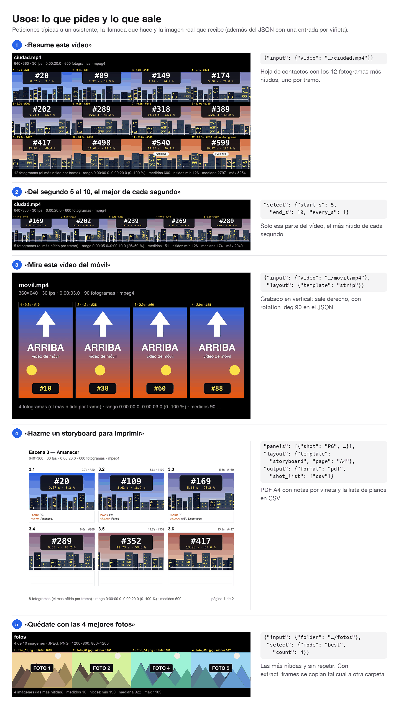
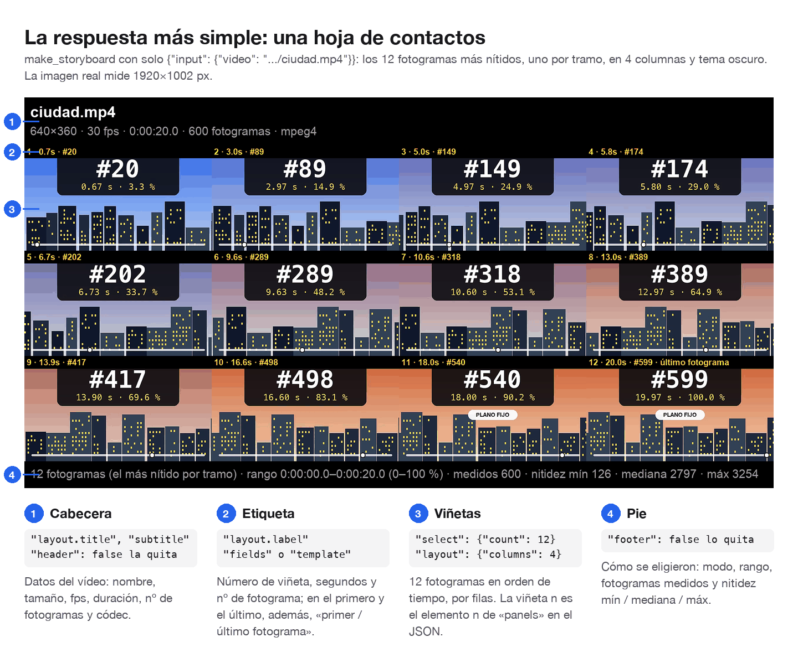
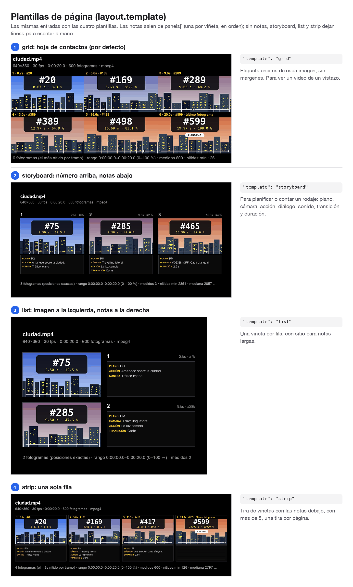
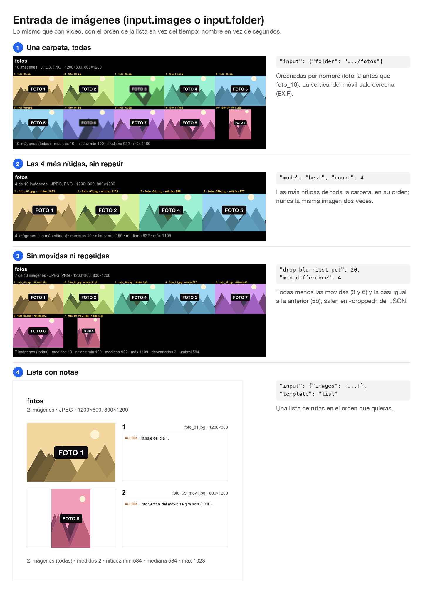
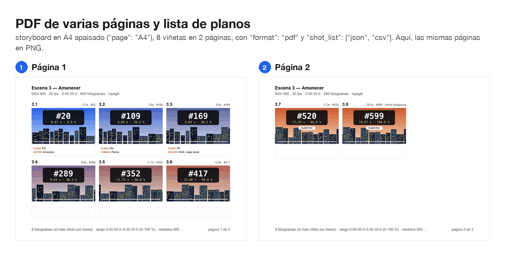
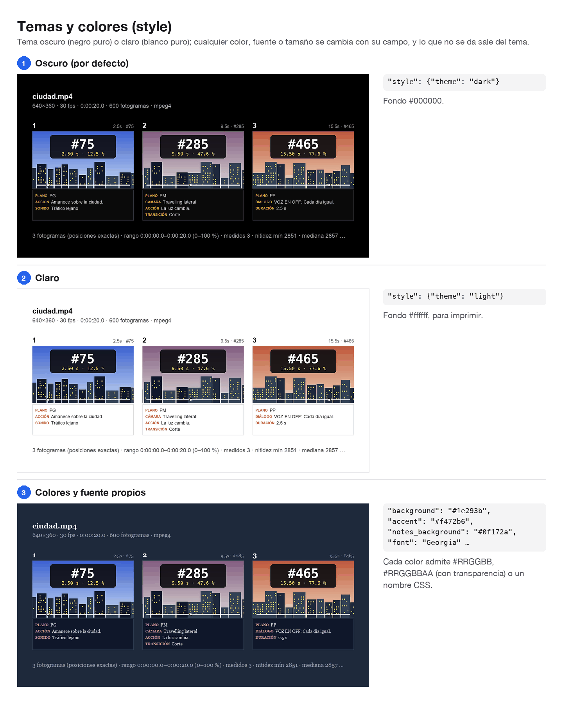

# storyboard-mcp

Servidor **MCP** (Model Context Protocol) que deja a un asistente como Claude **ver un vídeo o una serie de fotos**. Los convierte en **páginas de viñetas**: una hoja de contactos, un storyboard con notas, una lista o una tira, en PNG, JPG o un PDF de varias páginas. Por cada viñeta devuelve un JSON con su fotograma, su tiempo, su nitidez y sus notas.



- **Entrada:** un vídeo, una lista de imágenes o una carpeta. Se elige **exactamente uno** de los tres.
- **Elige bien los fotogramas:** el **más nítido** de cada tramo, los **N más nítidos** de todo el vídeo o la carpeta, posiciones **exactas** (en segundos, % o nº de fotograma) o las que digas tú viñeta a viñeta. También descarta los **movidos** y los **repetidos**.
- **Storyboard:** cada viñeta puede llevar notas de plano, cámara, acción, diálogo, sonido, transición y duración. Admite numeración propia (5.1, 12A, SH001), guías de formato (2.39:1, 9:16…), zona segura y tercios. Saca **PDF** en A4, Carta o 16:9, y la **lista de planos** en JSON y CSV.
- **Todo personalizable:** tema oscuro (negro puro) o claro (blanco puro) y cualquier color, fuente, tamaño o margen. Todo tiene un valor por defecto.
- **Una estructura JSON común** para todas las herramientas, definida como JSON Schema ([`schema.json`](schema.json)). Un error en los argumentos dice **qué campo** falla, qué se esperaba y qué llegó.
- Va en un único archivo, [`server.py`](server.py), y se ejecuta con [`uv`](https://docs.astral.sh/uv/), que instala las dependencias solo. **No hace falta ffmpeg:** decodifica con [PyAV](https://pyav.org).

**Guía de formatos de salida, con un ejemplo real de cada uno:** [docs/formatos.md](docs/formatos.md).

---

## Cómo se usa (en 3 pasos)

Un **MCP** es un conjunto de herramientas que se conecta a un asistente (Claude Code, Claude Desktop u otro cliente compatible). Una vez instalado **no lo ejecutas tú**: le pides al asistente lo que quieres, en lenguaje normal, y él llama a las herramientas.

**1. Instala `uv`** (una sola vez):
```bash
curl -LsSf https://astral.sh/uv/install.sh | sh        # macOS / Linux
# Windows (PowerShell): powershell -c "irm https://astral.sh/uv/install.ps1 | iex"
```

**2. Descarga el servidor y conéctalo a tu asistente:**
```bash
git clone https://github.com/Eliaxs1900/storyboard-mcp.git
claude mcp add --scope user storyboard -- uv run --script "$PWD/storyboard-mcp/server.py"
```
Con `claude mcp list` deberías ver `storyboard: … ✔ Connected`. Para Claude Desktop y otros clientes, mira [Instalación](#instalación).

**3. Pídeselo al asistente**, con la ruta del vídeo o de las fotos:

> «Mira `~/Movies/viaje.mp4` y hazme una hoja con 12 fotogramas que no salgan movidos.»

| Le dices | Lo que llama |
|---|---|
| «Resume este vídeo» | `make_storyboard {"input": {"video": "/…/viaje.mp4"}}` |
| «Uno cada 10 %, con fondo blanco» | `… "select": {"step_pct": 10}, "style": {"theme": "light"}` |
| «Solo del minuto 2 al 3, sin repetidos» | `… "select": {"start_s": 120, "end_s": 180, "min_difference": 6}` |
| «Un storyboard en PDF A4 con notas de cada plano» | `… "panels": [{"shot": "PG", "action": "…"}, …], "layout": {"template": "storyboard", "page": "A4"}, "output": {"format": "pdf"}` |
| «Las fotos de esta carpeta, sin las movidas» | `make_storyboard {"input": {"folder": "/…/fotos"}, "select": {"drop_blurriest_pct": 20}}` |
| «Copia las 3 mejores fotos de la ráfaga» | `extract_frames {"input": {"folder": "/…/rafaga"}, "select": {"mode": "best", "count": 3}, "output": {"dir": "/…/mejores"}}` |
| «El fotograma del minuto 5, el más nítido de alrededor, en grande» | `extract_frames {"input": {"video": "/…"}, "select": {"at_s": [300], "snap_s": 0.5}}` |

---

## Herramientas

| Herramienta | Qué hace | Escribe | Devuelve |
|---|---|---|---|
| `media_info` | Dice qué es la entrada: duración, fps, nº de fotogramas, tamaño y rotación del vídeo, o nombre, formato y tamaño de cada imagen. Es rápida. | nada | JSON |
| `make_storyboard` | Páginas de viñetas: `grid`, `storyboard`, `list` o `strip`. | PNG, JPG o PDF; opcionalmente, la lista de planos (JSON, CSV) y los fotogramas a tamaño completo | JSON con las rutas y una entrada por viñeta, más una **vista previa** de la página 1 |
| `extract_frames` | Fotogramas elegidos a tamaño completo, o copias de las imágenes elegidas. | `f00042.jpg`… o `001_<nombre>` | JSON con las rutas |
| `get_schema` | El JSON Schema de todo, con un ejemplo mínimo y uno completo de cada herramienta. También como recurso MCP `storyboard://schema`. | nada | JSON |

Cada respuesta es un JSON: va como texto y también como `structuredContent`, que sigue el `outputSchema` de la herramienta. Las rutas son **absolutas**. Sin `output.dir`, los archivos van a una carpeta temporal (`<temp>/storyboard-mcp/<nombre de la entrada>/`), cuya ruta viene en la respuesta.

### Lo que devuelve

La llamada mínima, `{"input": {"video": "…"}}`, da esta hoja. La viñeta *n* es el elemento *n* de `panels` en el JSON, con su fotograma, su tiempo y su nitidez:



### Plantillas

`layout.template` decide la página: `grid` (por defecto), `storyboard`, `list` o `strip`. Las notas de cada viñeta salen de `panels[]`:



### Fotos en vez de vídeo

Con `input.images` (una lista) o `input.folder` (una carpeta) se hace lo mismo, con el orden de la lista en lugar del tiempo. Las fotos del móvil se giran según su orientación EXIF. Y `"mode": "best"` se queda con las más nítidas sin repetir ninguna:



## La estructura JSON común

Todas las herramientas reciben las mismas secciones. **Solo `input` es obligatoria**: `{"input": {"video": "/ruta/clip.mp4"}}` ya funciona con los valores por defecto. Una clave desconocida da error (con sugerencia si es una errata), nunca se ignora sin avisar.

| Sección | Para qué | Campos principales (valor por defecto) |
|---|---|---|
| `input` | Qué mirar: **exactamente uno** de `video`, `images` o `folder` | `video` (ruta) · `images` (lista de rutas, 1–1000) · `folder` (ruta: todas las imágenes) + `pattern` (opcional, p. ej. `"*.jpg"`; sin distinguir mayúsculas) |
| `select` | Qué fotogramas o imágenes son viñetas | `mode`: `sharpest` (el más nítido de cada tramo), `even` (el del centro), `best` (los N más nítidos), `all` (todos); `auto` es `sharpest` en vídeo y, en imágenes, `all` (o `sharpest` si das `count`) · `count` (12) · `every_s` / `every_pct` · posiciones exactas: `step_pct`, `step_s`, `at_pct`, `at_s`, `at_frames`, `at_images`, `at_names` · `snap_s` (0) · rango: `start_s`, `end_s`, `start_pct`, `end_pct` · filtros: `min_sharpness`, `drop_blurriest_pct`, `min_gap_s`, `min_difference` |
| `panels` | Notas por viñeta, en orden (o con posición propia) | `shot`, `camera`, `action`, `dialogue`, `sound`, `transition`, `duration_s`, `number`; posición: `frame`, `at_s`, `at_pct`, `image`, `image_name` |
| `layout` | Cómo se colocan | `template` (`grid`) · `columns` (grid 4, storyboard 3) · `rows` · `page` (`auto`, `A4`, `Letter`, `16:9`) · `orientation` · `panel_width` (480) · `aspect` (`source`) · `fit` · `margin`, `gap`, `padding` · `header`, `title`, `subtitle`, `footer`, `footer_text` · `label`, `numbering`, `notes`, `guides` · `language` (`es`, `en`) |
| `style` | Colores, fuentes y tamaños | `theme` (`dark`: fondo `#000000`; `light`: `#ffffff`) · `background`, `text`, `text_secondary`, `accent`, `label_background`, `label_text`, `panel_border`, `border_width`, `notes_background`, `notes_text`, `notes_rule`, `guides` · `font`, `font_bold` · `title_size`, `text_size`, `label_size`, `number_size`, `notes_size` · `sharpen` (0.5) |
| `output` | Dónde y cómo se guarda | `dir` (temporal) · `name` (`<entrada>_<plantilla>`) · `format` (`png`, `jpg`, `pdf`; `webp`, `gif`, `mp4` y `webm`, previstos) · `quality` (90) · `dpi` (150) · `shot_list` (`["json", "csv"]`) · `csv_style` (`standard`; `excel_es` para Excel en español) · `frames` · `also_without_labels` · `preview` (true). En `extract_frames`: `dir`, `format` y `names` (`numbered` o `original`) |

- **Posiciones:** los fotogramas van de 0 a `frames − 1`. Los segundos cuentan desde el primer fotograma (0,0 s). En %, 0 es el primer fotograma o la primera imagen y 100 el último. Las imágenes se indican por índice (0…) o por nombre de archivo.
- **Colores:** `#RRGGBB`, `#RRGGBBAA` (con transparencia), `#RGB`, `#RGBA` o un nombre CSS (`"white"`). Los valores de lista (`"PDF"`, `"a4"`, `"Storyboard"`) valen en mayúsculas o minúsculas.
- **Avisos:** si salen menos viñetas de las pedidas, o se ignora algún campo, `warnings` dice por qué.
- **Errores:** todos a la vez, cada uno con su ruta. Por ejemplo:
  ```
  make_storyboard: 2 problems in the arguments:
  - layout.colums: unknown field "colums". Did you mean "columns"? Allowed here: template, columns, rows, …
  - style.background: "#12" is not a valid colour; use #RRGGBB or #RRGGBBAA (also #RGB, #RGBA) or a CSS colour name such as "white", "black" or "navy"
  ```

Un ejemplo completo: un storyboard en PDF con notas, numeración de escena, guía de 2.39:1, tema claro y la lista de planos.
```json
{
  "input": {"video": "/Users/ana/Movies/clip.mp4"},
  "select": {"at_s": [1.5, 6, 12.5, 20], "snap_s": 0.5},
  "panels": [
    {"shot": "PG", "camera": "fijo", "action": "Amanece sobre la ciudad.", "sound": "tráfico lejano"},
    {"shot": "PM", "camera": "travelling lateral", "action": "Ana cruza la calle.", "dialogue": "ANA: Llego tarde.", "transition": "corte"},
    {"number": "2A", "shot": "PP", "action": "Mira el reloj.", "duration_s": 2.5},
    {"shot": "PG", "camera": "grúa ascendente", "transition": "fundido a negro"}
  ],
  "layout": {"template": "storyboard", "columns": 2, "page": "A4", "numbering": {"format": "5.{n}"},
             "label": {"fields": ["timecode", "frame"]}, "guides": {"aspects": ["2.39:1"]}, "title": "Escena 5 — La calle"},
  "style": {"theme": "light", "accent": "#c2410c", "font": "Helvetica"},
  "output": {"dir": "/Users/ana/Desktop/storyboard", "name": "escena5", "format": "pdf", "shot_list": ["json", "csv"]}
}
```

Ese tipo de llamada da un PDF de varias páginas como este, más la lista de planos:



Todo lo visual se puede cambiar. Lo que no se da sale del tema, oscuro (negro puro) o claro (blanco puro):



La referencia completa de cada campo, con sus tipos, límites y valores por defecto, está en [`schema.json`](schema.json) y en la herramienta `get_schema`. Lo que devuelve cada herramienta, con imágenes, está en [docs/formatos.md](docs/formatos.md).

## Cambios respecto a la versión 1 (frame-extractor)

La versión 2 cambia los nombres y la forma de los argumentos para unificar vídeo e imágenes. Es un MCP propio, sin usuarios externos, así que no hay capa de compatibilidad.

| Versión 1 | Versión 2 |
|---|---|
| `video_info(video_path)` | `media_info {"input": {"video": …}}` |
| `video_contact_sheet(video_path, out_png, …)` | `make_storyboard {"input": …, "output": {"dir", "name", "format"}}` |
| `video_frames(video_path, out_dir, frames / times_s / positions_pct)` | `extract_frames {"select": {"at_frames" / "at_s" / "at_pct"}, "output": {"dir"}}` |
| `count`, `mode`, `step_pct`, `step_s`, `start_s`, `end_s`, `min_*` | iguales, dentro de `select` |
| `interval_s`, `interval_pct` | `select.every_s`, `select.every_pct` |
| `positions_pct`, `positions_s`, `sharpest_within_s` | `select.at_pct`, `select.at_s`, `select.snap_s` |
| `columns`, `thumb_width`, `gap_px`, `header`, `footer` | `layout.columns`, `layout.panel_width`, `layout.gap`, `layout.header`, `layout.footer` |
| `label`, `label_fields`, `label_template` (`{index}`, `{time_hms}`) | `layout.label.show`, `.fields`, `.template` (`{number}`, `{timecode}`) |
| `background`, `label_size`, `sharpen` | `style.background`, `style.label_size`, `style.sharpen` |
| `both_versions`, `save_frames_dir`, `jpeg_quality` | `output.also_without_labels`, `output.frames`, `output.quality` |
| Respuesta `images: {con_labels, sin_labels}`, `frames[]` | `pages[]` (y `pages_without_labels`), `panels[]` |

## Instalación

Requisitos: macOS, Linux o Windows con [`uv`](https://docs.astral.sh/uv/getting-started/installation/). La primera ejecución descarga `mcp`, `av`, `pillow`, `pillow-heif` (fotos HEIC del iPhone) y `pydantic` en un entorno aislado.

```bash
git clone https://github.com/Eliaxs1900/storyboard-mcp.git
```

**Claude Code**
```bash
claude mcp add --scope user storyboard -- uv run --script /RUTA/A/storyboard-mcp/server.py
```

**Claude Desktop y otros clientes MCP** (en Claude Desktop, el archivo es `claude_desktop_config.json`):
```json
{
  "mcpServers": {
    "storyboard": { "command": "uv", "args": ["run", "--script", "/RUTA/A/storyboard-mcp/server.py"] }
  }
}
```

## Probar sin cliente MCP, pruebas y esquema

`server.py` también se puede importar: `run_tool` valida los argumentos y ejecuta la herramienta igual que por MCP.
```bash
uv run --with "mcp>=1.10,<2" --with av --with pillow --with pillow-heif python -c "
import importlib.util as u; s=u.spec_from_file_location('s','server.py'); m=u.module_from_spec(s); s.loader.exec_module(m)
print(m.run_tool('make_storyboard', {'input': {'video': 'mi_video.mp4'}})[0]['pages'])"
```

- **Pruebas** (con vídeo e imágenes generados): `uv run --script tests/test_server.py`
- **Regenerar `schema.json`** (las pruebas avisan si no coincide con el código): `uv run --script server.py --schema > schema.json`
- **Regenerar las figuras y los JSON de la guía:** `uv run --script docs/generar_ejemplos.py`

## Notas

- **Memoria:** el modo por tramos mide todos los fotogramas del rango con copias pequeñas y guarda solo los elegidos, ya reducidos al tamaño de la viñeta. Las posiciones exactas saltan a cada punto sin decodificar todo el vídeo, así que son el modo rápido en películas largas.
- **Rotación:** los vídeos de móvil guardan un giro en el archivo y las fotos, la orientación EXIF. Las imágenes salen tal como se grabaron: `rotation_deg` y `displayed_size` lo indican.
- **Límites:** 1000 imágenes por entrada, 500 viñetas y 200 páginas por llamada, y 150 Mpx por página. Si se superan, el error dice cómo repartirlo (`layout.rows`, `count`…).
- **PDF:** las páginas se guardan como imagen dentro del PDF, así que el texto no se puede seleccionar.
- **Problema conocido:** si ejecutas el servidor desde una carpeta con archivos que se llamen como módulos estándar de Python (`inspect.py`, `json.py`…), la importación de PyAV puede fallar. Usa la ruta absoluta de `server.py`, como en los ejemplos.

## ffmpeg incluido (`bin/ffmpeg`)

El repositorio trae una copia de la herramienta `ffmpeg`, para que no tengas que instalarla: un ejecutable para Mac con Apple Silicon (macOS 13 o posterior) que solo usa librerías del propio macOS. El servidor no la necesita para leer vídeos (usa PyAV); sirve para todo lo demás.

- **De dónde sale:** compilado sin cambios del código oficial de FFmpeg ([github.com/FFmpeg/FFmpeg](https://github.com/FFmpeg/FFmpeg), versión `n9.0.2`) con [`build-ffmpeg.sh`](build-ffmpeg.sh). La versión, el commit, las opciones de compilación y el SHA-256 están en [`bin/LICENSE-ffmpeg.md`](bin/LICENSE-ffmpeg.md).
- **Licencia:** LGPL 2.1 o posterior (sin partes GPL ni «nonfree»), texto en [`bin/COPYING.LGPLv2.1`](bin/COPYING.LGPLv2.1).
- **¿Es la última versión?** El flag `--is-ffmpeg-updated` lo compara con la última versión publicada en el GitHub oficial (una sola consulta a la API de GitHub; usa `GITHUB_TOKEN` si está definido):

```bash
uv run --script server.py --is-ffmpeg-updated
# bin/ffmpeg está al día: es n9.0.2, la última versión publicada en github.com/FFmpeg/FFmpeg.
```

- **Código de salida del flag:** `0` al día, `1` hay una versión más nueva (y dice cómo actualizar), `2` no se pudo comprobar (sin red, o `bin/ffmpeg` no se puede ejecutar).
- **Actualizarlo:** `./build-ffmpeg.sh <etiqueta>`, por ejemplo `./build-ffmpeg.sh n9.0.3`. Después, actualiza `bin/LICENSE-ffmpeg.md`.

## Licencia

Código: [MIT](LICENSE). `bin/ffmpeg` es FFmpeg, bajo LGPL 2.1 o posterior ([detalles](bin/LICENSE-ffmpeg.md)). Las imágenes de [`docs/`](docs/) salen de un vídeo y unas fotos sintéticos que crea [`docs/generar_ejemplos.py`](docs/generar_ejemplos.py).
