# Formatos de salida de storyboard-mcp

Qué devuelve cada herramienta, cómo es cada salida y qué argumentos la producen. Está pensada para que la lea un asistente (una IA) sin contexto previo, y también una persona.

Todas las imágenes de esta página son **salidas reales** del servidor. Las crea [`generar_ejemplos.py`](generar_ejemplos.py) a partir de un vídeo y unas fotos sintéticos. Cada fotograma del vídeo lleva escritos su número, su tiempo y su %, así que se puede comprobar a simple vista que las etiquetas y el JSON dicen la verdad. Las respuestas JSON completas de cada ejemplo están en [`formatos/json/`](formatos/json/). En ellas, las rutas empiezan por `/Users/ana/ejemplos/`, que es una ruta de ejemplo.

> **Lo esencial, en 6 líneas**
> 1. Llama con un objeto JSON. **Solo `input` es obligatorio**: `{"input": {"video": "/ruta/absoluta/clip.mp4"}}`.
> 2. `input` lleva **exactamente uno** de estos tres: `video` (ruta), `images` (lista de rutas) o `folder` (ruta).
> 3. La respuesta es **JSON**, con las **rutas absolutas** de los archivos creados: ábrelos para ver el resultado. `make_storyboard` añade una **vista previa** de la página 1 como imagen.
> 4. En el vídeo, los fotogramas van de `0` a `frames − 1`, los segundos cuentan desde el primer fotograma (0,0 s) y en % el 0 es el primer fotograma y el 100 el último. Las imágenes van por índice (`0`…) o por nombre de archivo.
> 5. Un error en los argumentos dice **qué campo** falla (p. ej. `layout.columns`), qué se esperaba y qué llegó. Una clave desconocida nunca se ignora sin avisar.
> 6. El esquema completo está en la herramienta `get_schema`, en el recurso MCP `storyboard://schema` y en [`schema.json`](../schema.json).

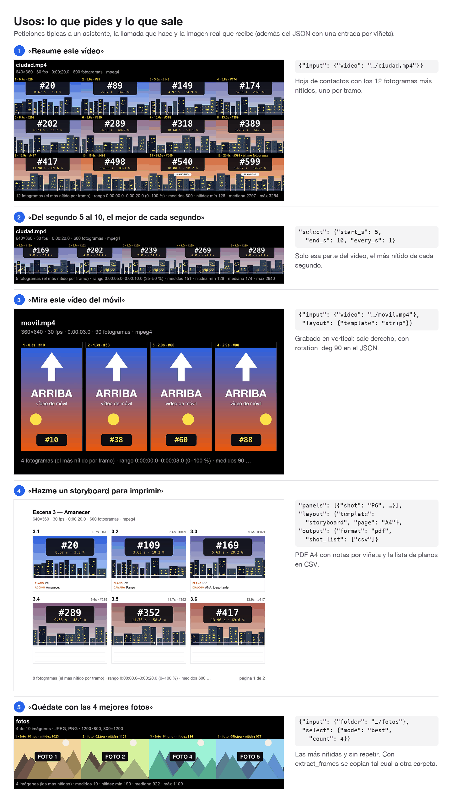

**Índice:** [Resumen](#1-resumen) · [media_info](#2-media_info) · [make_storyboard](#3-make_storyboard): [mínimo](#31-la-llamada-mínima), [plantillas](#32-plantillas-de-página), [selección](#33-qué-fotogramas-se-eligen), [filtros](#34-filtros-sin-movidos-ni-repetidos), [etiquetas](#35-etiquetas-y-numeración), [guías](#36-guías), [temas](#37-temas-colores-y-fuentes), [imágenes](#38-entrada-de-imágenes), [PDF y lista de planos](#39-pdf-páginas-y-lista-de-planos), [archivos](#310-archivos-que-escribe), [respuesta](#311-la-respuesta-json) · [extract_frames](#4-extract_frames) · [get_schema](#5-get_schema-y-schemajson) · [Errores](#6-errores)

---

## 1. Resumen

| Herramienta | Úsala para | Escribe | Devuelve |
|---|---|---|---|
| `media_info` | Saber qué es la entrada y sus límites (duración, fps, nº de fotogramas, tamaños) antes de pedir posiciones | nada | JSON: `kind`, y `video` o `images` |
| `make_storyboard` | **Ver** un vídeo o unas fotos, y hacer storyboards | Páginas PNG o JPG, o un PDF. Opcionalmente, la lista de planos (JSON y CSV) y los fotogramas a tamaño completo | JSON: `pages`, `pdf`, `panels`, `dropped`, `selection`, `layout`, `input`, `warnings`. Además, una **imagen**: la vista previa de la página 1 |
| `extract_frames` | Ver un detalle a **tamaño completo**, o sacar las mejores fotos de una serie | Un JPEG o PNG por fotograma, o copias de las imágenes | JSON: `dir`, `files`, `dropped`, `selection`, `input` |
| `get_schema` | Consultar qué acepta cada campo | nada | JSON Schema de entrada y de respuesta, más ejemplos |

Orden habitual: `media_info` → `make_storyboard` (mirar la página) → `extract_frames` (si hace falta más detalle) → `make_storyboard` otra vez, con notas, para el storyboard final.

Todas las herramientas reciben las **mismas secciones**: `input`, `select`, `panels`, `layout`, `style` y `output`. Cada herramienta usa solo las suyas: `media_info` solo `input`; `extract_frames`, `input`, `select` y `output`.

## 2. `media_info`

```json
{"input": {"video": "/Users/ana/ejemplos/ciudad.mp4"}}
```
```json
{
 "kind": "video",
 "video": {"path": "/Users/ana/ejemplos/ciudad.mp4", "duration_s": 20.0, "fps": 30.0, "frames": 600, "size": [640, 360], "rotation_deg": 0, "displayed_size": [640, 360], "codec": "mpeg4"}
}
```

| Campo | Qué es |
|---|---|
| `duration_s`, `fps`, `frames` | Duración en segundos, fotogramas por segundo y número de fotogramas. Los fotogramas van de `0` a `frames − 1`. |
| `size` / `displayed_size` | `[ancho, alto]` tal como está en el archivo / tal como se ve después de girarlo. Es el tamaño de los fotogramas que escribe `extract_frames`. |
| `rotation_deg` | 0, 90, 180 o 270. Es el giro (en sentido horario) que se aplica a cada imagen. Los móviles graban de lado y guardan este giro en el archivo. |

Con imágenes (`{"input": {"folder": ".../fotos"}}`) se obtiene `count`, `formats` (cuántas hay de cada formato), `sizes` (los tamaños distintos) y una entrada por imagen: `index`, `path`, `name`, `format`, `size`, `displayed_size` (con la orientación EXIF ya aplicada), `bytes` y, si es idéntica byte a byte a una anterior, `duplicate_of` con el índice de esa. JSON completo: [`media_info_fotos.json`](formatos/json/media_info_fotos.json).

## 3. `make_storyboard`

### 3.1 La llamada mínima

Con solo `{"input": {"video": ".../ciudad.mp4"}}` sale una **hoja de contactos**: los 12 fotogramas más nítidos, uno por cada doceavo del vídeo, en 4 columnas y con tema oscuro.

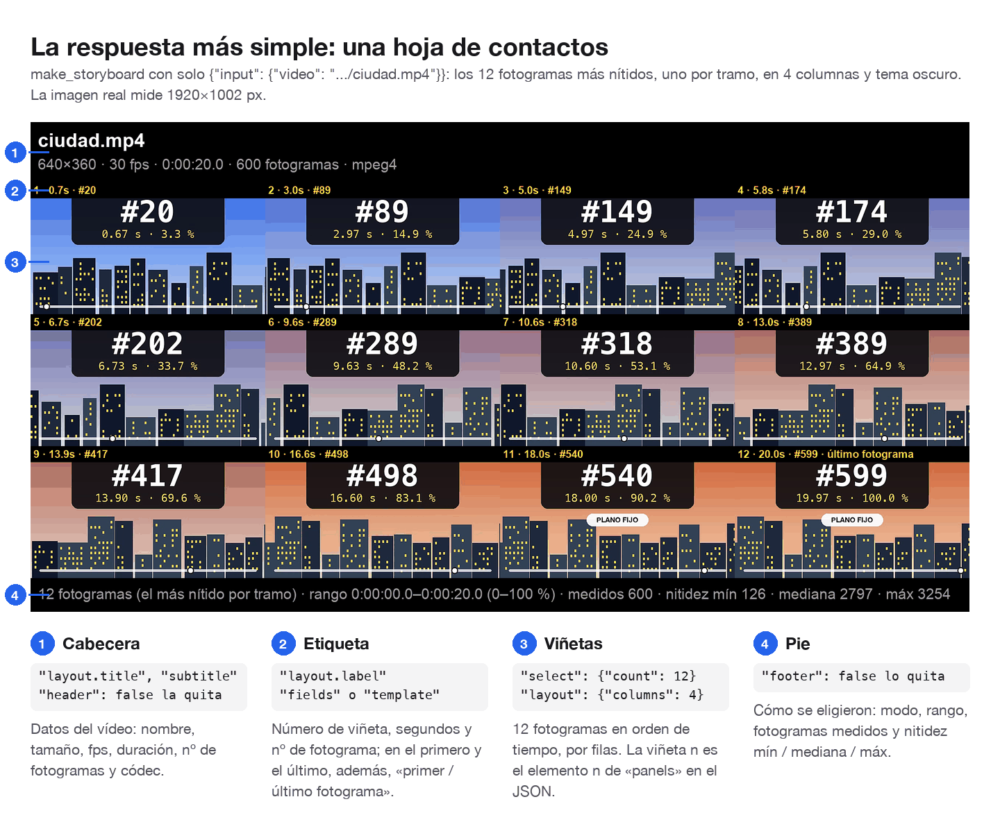

La viñeta *n* de la imagen es el elemento *n* de `panels` en el JSON, con su fotograma (`frame`), su tiempo (`time_s`, `timecode`), su posición (`pct`) y su nitidez. Para hablar de una viñeta concreta, usa su `frame`. JSON: [`minimo.json`](formatos/json/minimo.json).

### 3.2 Plantillas de página

`layout.template` decide la disposición. Las notas de `panels[]` (una por viñeta, en orden) se dibujan en `storyboard`, `list` y `strip`. Sin notas, esas plantillas dejan líneas para escribir a mano.

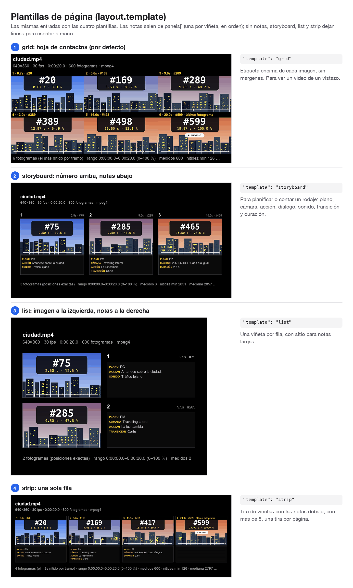

| Plantilla | Cómo es | Columnas por defecto | Úsala para |
|---|---|---|---|
| `grid` (defecto) | Hoja de contactos: etiqueta sobre cada imagen, sin márgenes | 4 | ver un vídeo de un vistazo |
| `storyboard` | Número grande encima, notas debajo | 3 | planificar o contar un rodaje |
| `list` | Imagen a la izquierda; número y notas a la derecha | 1 | notas largas |
| `strip` | Una sola fila con notas debajo (una tira por página) | todas, hasta 8 | secuencias cortas |

Las notas de cada viñeta son `shot` (tipo de plano), `camera` (movimiento), `action`, `dialogue` (diálogo o voz en off), `sound`, `transition` y `duration_s`. Todas son texto libre, salvo `duration_s`, que es un número. `layout.notes.fields` usa esos mismos nombres. `layout.notes.fields` elige cuáles y en qué orden; `layout.notes.show` las muestra también en `grid`.

### 3.3 Qué fotogramas se eligen

El vídeo de muestra se desenfoca en la primera mitad de cada segundo, como uno movido.

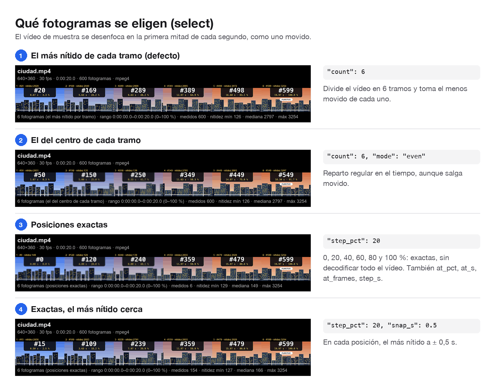

| Quieres | `select` |
|---|---|
| N fotogramas repartidos y nítidos (defecto: 12) | `{"count": N}`, con `mode` `"sharpest"` |
| N repartidos, aunque salgan movidos | `{"count": N, "mode": "even"}` |
| Los N más nítidos de todo el vídeo o la carpeta, sin repetir | `{"mode": "best", "count": N}` (pueden salir todos de la misma parte del vídeo) |
| Uno cada N segundos **exactos** (0, N, 2N…) | `{"step_s": N}`; añade `"snap_s": 0.5` para evitar los movidos |
| El más nítido de cada tramo de N segundos o N % | `{"every_s": N}` o `{"every_pct": N}` (los tiempos salen irregulares: es el mejor de cada tramo) |
| Posiciones exactas | `{"step_pct": 10}` (0, 10…100 %), `{"step_s": 30}`, `{"at_pct": [0, 50, 100]}`, `{"at_s": [1.5, 12]}`, `{"at_frames": [0, 240]}` |
| Exactas, pero sin movidos | añade `"snap_s": 0.5`: solo se mueve la posición cuyo fotograma es claramente más borroso (menos del 80 %) que el más nítido a ± 0,5 s; las nítidas se quedan exactas |
| Solo una parte | `{"start_s": 120, "end_s": 180}` o `{"start_pct": 25, "end_pct": 75}` |
| Cada viñeta con su fotograma y sus notas | sin `select`: `"panels": [{"frame": 120, "action": "…"}, {"at_s": 9.5, "action": "…"}]` |

Las posiciones exactas saltan a cada punto sin decodificar todo el vídeo, así que son **el modo rápido en películas largas**. Los tramos miden todos los fotogramas del rango. En `sharpest`, dos viñetas seguidas quedan separadas al menos medio tramo, para que no salgan dos fotogramas casi pegados. `selection.mode` dice qué modo se usó: `sharpest`, `even`, `best`, `all`, `positions` o `panels`.

Si salen menos viñetas de las pedidas, o alguna posición exacta cae en un fotograma movido, `warnings` lo dice y propone el arreglo. Por ejemplo: `"select: 8 panels asked for, 7 given: 1 removed by the filters (see dropped)"`.

### 3.4 Filtros: sin movidos ni repetidos

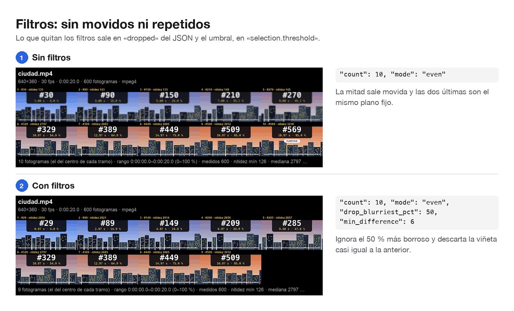

| Filtro | Qué hace |
|---|---|
| `drop_blurriest_pct: 30` | Ignora el 30 % más borroso de los fotogramas. Ojo: la nitidez mide bordes, así que una imagen lisa (colores planos, un logo) puntúa bajo sin estar movida |
| `min_sharpness: 800` | Ignora los que tengan menos nitidez que ese valor. `selection.sharpness_stats` de una respuesta anterior da valores típicos |
| `min_difference: 6` | Descarta la viñeta casi igual a la anterior. Es la diferencia media, de 0 a 255, entre copias en color de 64×36: 1–2 quita solo las casi idénticas, 3 va bien con cosas pequeñas moviéndose sobre un fondo fijo y 4–8 quita las repeticiones de un plano fijo |
| `min_gap_s: 2` | Vídeo: descarta una viñeta a menos de 2 s de la anterior |

Si un filtro descarta el fotograma elegido en un tramo, se toma el siguiente mejor de ese tramo; la viñeta solo se pierde si no queda ninguno, y entonces `warnings` dice qué filtro bajar. Lo descartado aparece en `dropped`, con su motivo (`reason`), la viñeta con la que se comparó (`similar_to`) y la diferencia medida (`difference`). Del ejemplo con filtros ([`filtros_con.json`](formatos/json/filtros_con.json)):
```json
"dropped": [{"frame": 569, "reason": "min_difference", "similar_to": 509, "difference": 4.03}],
"warnings": ["select: 10 panels asked for, 9 given: 1 removed by the filters (see dropped); to get more, lower min_difference (now 6; 2-3 suits a fixed background) or ask for fewer panels"],
"selection": {"mode": "even", "range_s": [0.0, 19.97], "range_pct": [0.0, 100.0], "measured": 600, "threshold": 2797.1, "sharpness_stats": {"min": 125.5, "p25": 149.2, "median": 2797.1, "p75": 2897.5, "max": 3254.5}}
```

### 3.5 Etiquetas y numeración

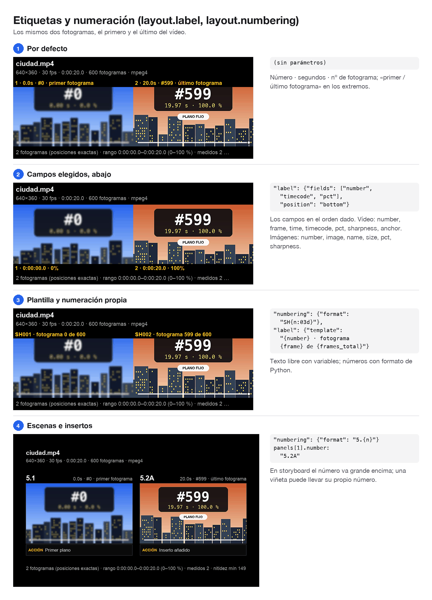

- `layout.label.fields`: los campos, en orden. Con vídeo: `number`, `frame` (#123), `time` (4.1s), `timecode` (0:00:04.1), `pct`, `sharpness`, `sharpness_pct`, `anchor` (*primer / último fotograma*). Con imágenes: `number`, `image` (#3), `name` (nombre del archivo), `size`, `pct`, `sharpness`, `sharpness_pct`.
- `layout.label.template`: texto libre con variables: `{number}` `{frame}` `{frames_total}` `{time}` `{timecode}` `{pct}` `{pct1}` `{sharpness}` `{sharpness_pct}` `{anchor}` `{image}` `{name}` `{images_total}` `{size}`.
- `layout.label.position`: `top` o `bottom`. `layout.label.show: false` quita las etiquetas.
- `layout.numbering.format`: `{n}` es el número que corre, con el formato de Python: `"5.{n}"` → 5.1, 5.2…; `"SH{n:03d}"` → SH001. `start` es el primer número y `step`, el salto: `{"start": 10, "step": 10, "format": "SH{n:03d}"}` → SH010, SH020, SH030. `panels[i].number` pone el número de una sola viñeta, por ejemplo `"12A"` para un inserto.
- `layout.language`: `es` (defecto) o `en` para los textos de la página: «primer fotograma», «ACCIÓN», «página 1 de 3»…

### 3.6 Guías

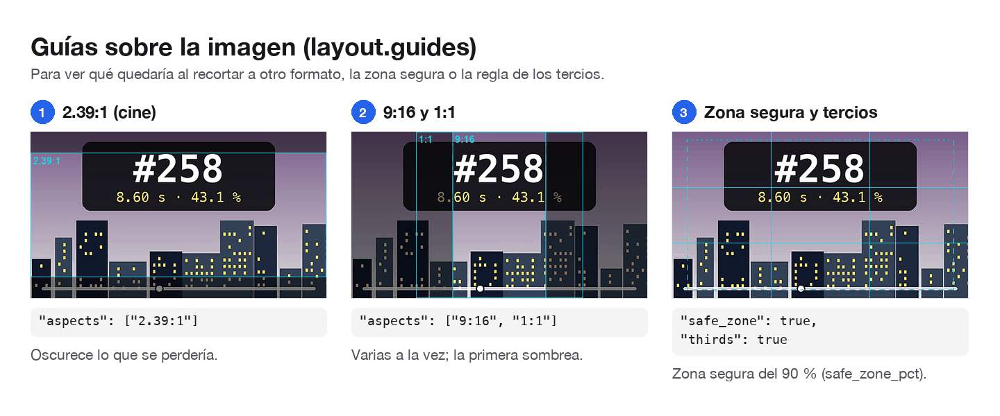

`layout.guides`: `aspects` (cualquiera de `16:9`, `9:16`, `4:3`, `3:4`, `1:1`, `4:5`, `1.85:1`, `2:1` o `2.39:1`) dibuja lo que quedaría al recortar a ese formato. `shade` (por defecto `true`) oscurece lo que queda fuera del primero. `safe_zone` y `safe_zone_pct` (90) dibujan la zona segura, y `thirds`, la regla de los tercios. El color es `style.guides`.

### 3.7 Temas, colores y fuentes

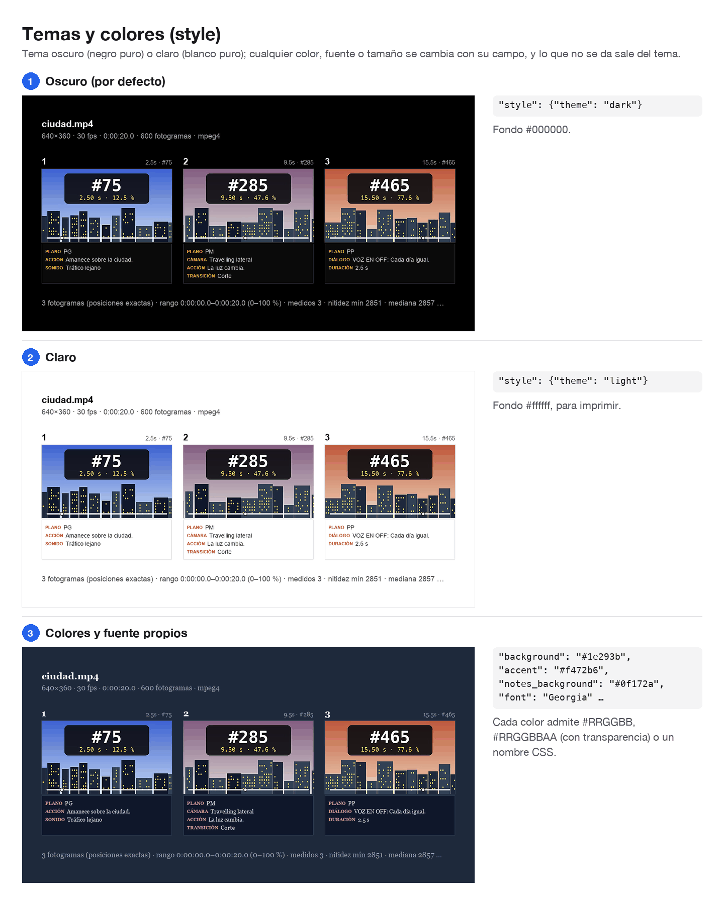

`style.theme` da los valores por defecto. Cualquier campo los sustituye y lo que no se da sale del tema.

| Campo de `style` | `dark` (defecto) | `light` | Qué colorea |
|---|---|---|---|
| `background` | `#000000` | `#ffffff` | página y bandas de `fit: "contain"`; en PNG admite alfa (`#00000000` = transparente) |
| `text` / `text_secondary` | `#ffffff` / `#a3a3a3` | `#000000` / `#525252` | título y números / subtítulo, pie y etiquetas de `storyboard` y `list` |
| `label_background` / `label_text` | `#000000` / `#facc15` | `#ffffff` / `#000000` | banda de la etiqueta sobre la imagen (`grid`, `strip`) |
| `accent` | `#facc15` | `#b45309` | títulos de las notas (ACCIÓN, DIÁLOGO…) |
| `panel_border` / `border_width` | `#3f3f46` / 0 en grid, 1 en el resto | `#d4d4d4` | bordes de imágenes y notas |
| `notes_background`, `notes_text`, `notes_rule` | `#0a0a0a`, `#e5e5e5`, `#2e2e2e` | `#ffffff`, `#171717`, `#e5e5e5` | cajas de notas y sus líneas |
| `guides` | `#22d3ee` | `#0891b2` | guías |

- **Colores:** `#RRGGBB`, `#RRGGBBAA`, `#RGB`, `#RGBA` o un nombre CSS (`"white"`, `"navy"`).
- **Fuentes:** `font` y `font_bold` aceptan un archivo `.ttf`, `.otf` o `.ttc`, o el nombre de una fuente instalada (`"Helvetica"`, `"Georgia"`, `"DejaVu Sans"`). Si no se da `font_bold`, se busca la versión negrita de `font`.
- **Tamaños, en px:** `title_size`, `text_size`, `label_size`, `number_size` y `notes_size`. Si no se dan, salen del ancho de la página y de las imágenes.
- **Espacios, en `layout`:** `margin` (grid 0, el resto 48; strip 24), `gap` (grid 0, storyboard 28, list 24, strip 12) y `padding`.
- **Imagen:** `layout.panel_width` (480 px), `layout.aspect` (`source` o un formato fijo), `layout.fit` (`contain` deja bandas; `cover` recorta el centro) y `style.sharpen` (0,5).

### 3.8 Entrada de imágenes

Es lo mismo que con vídeo, pero con el orden de la lista en lugar del tiempo.

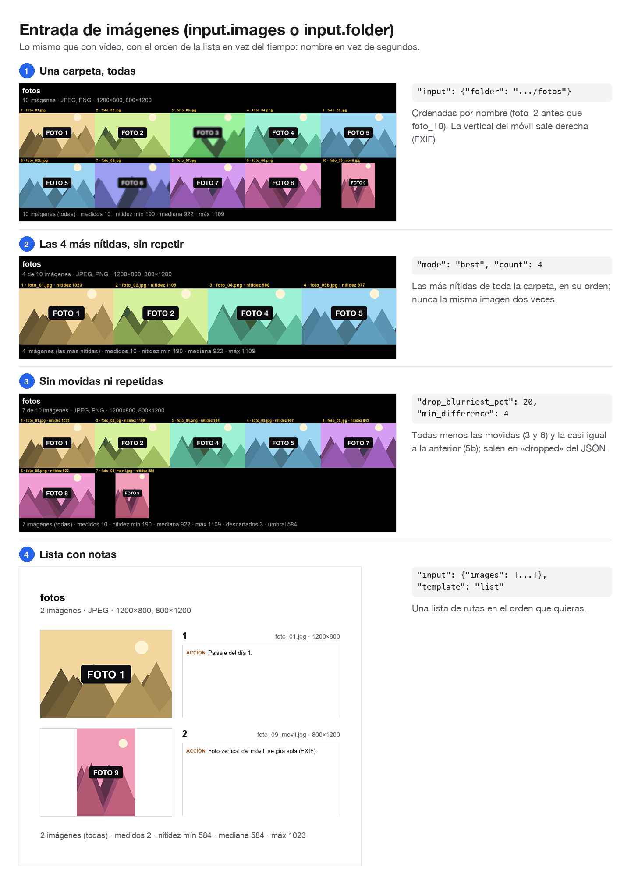

- `{"images": [rutas]}`: en el orden dado. `{"folder": ruta}`: todas las imágenes de la carpeta (sin subcarpetas), ordenadas por nombre de forma natural (foto_2 antes que foto_10). Con `"pattern": "*.jpg"`, solo las que coinciden (sin distinguir mayúsculas).
- Formatos: jpg, png, webp, gif (el primer fotograma), bmp, tiff y heic (fotos del iPhone). Las fotos de móvil se giran según su orientación EXIF.
- Por defecto se usan **todas**. Con `count` se elige la más nítida de cada tramo de la lista, y con `mode: "best"` y `count`, las N más nítidas de toda la lista, sin repetir ninguna. En `best`, una imagen cuenta como repetida si su diferencia con una ya elegida es menor que `min_difference` (1 si no se da; 0 = solo copias exactas). Las que quita salen en `dropped` con `similar_to` y `difference`, y `warnings` lo avisa. Las copias idénticas byte a byte las marca también `media_info`, con `duplicate_of`. `drop_blurriest_pct` y `min_difference` quitan las movidas y las repetidas, como en una ráfaga. Para elegir unas concretas: `at_images: [0, 4]` (índices), `at_names: ["foto_05.jpg"]` o `at_pct`.
- No admiten campos de tiempo (`at_s`, `every_s`, `snap_s`…): el error lo dice y propone la alternativa.
- En cada viñeta, el JSON trae `image` (índice), `name` y `source` (la ruta original) en lugar de `frame` y `time_s`.

Lo que descartaron los filtros del ejemplo ([`fotos_mejores.json`](formatos/json/fotos_mejores.json)):
```json
"dropped": [{"image": 2, "name": "foto_03.jpg", "reason": "min_sharpness"},
            {"image": 5, "name": "foto_05b.jpg", "reason": "min_difference", "similar_to": 4, "difference": 0.01},
            {"image": 6, "name": "foto_06.jpg", "reason": "min_sharpness"}]
```

### 3.9 PDF, páginas y lista de planos

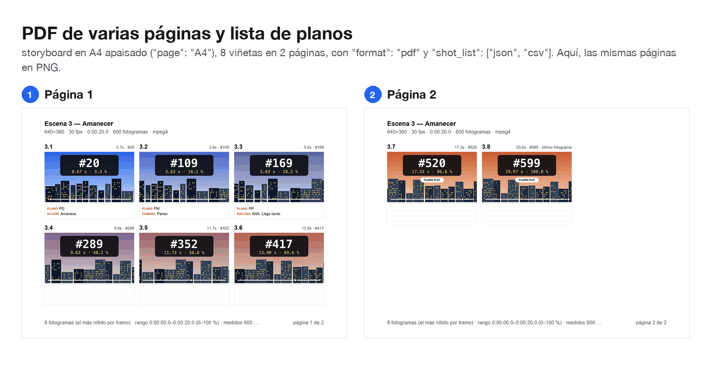

- `layout.page`: `auto` (la página crece hasta que caben todas; por defecto), `A4`, `Letter` o `16:9`, a `output.dpi` (150), con `layout.orientation` `landscape` (defecto) o `portrait`. En una página fija, las viñetas se escalan para que quepan `layout.rows` filas. Si no se da `rows`: storyboard 2 (apaisado) o 3; grid 3 o 5; list 2 o 4; y nunca más de las que hacen falta, para que las imágenes salgan lo más grandes posible.
- Si no caben en una página, se reparten en varias: `_p1`, `_p2`… en PNG o JPG, o un único PDF con una página por página. Cada página indica qué viñetas lleva (`pages[].panels`).
- `output.shot_list: ["json", "csv"]` escribe la **lista de planos**: una fila por viñeta con su número, página, posición y notas. El CSV va en UTF-8 con BOM, para que Excel abra bien los acentos. Por defecto separa con comas, usa punto decimal, nombres de columna en inglés y todas las columnas. Con `"csv_style": "excel_es"` lo abre bien Excel en español: separa con `;`, usa coma decimal, pone los nombres de columna en español, quita las que van siempre vacías y deja los números de viñeta como texto, para que «3.1» no se convierta en una fecha. Este es el estilo por defecto:

```csv
n,number,page,frame,time_s,timecode,pct,image,name,shot,camera,action,dialogue,sound,transition,duration_s,sharpness,file,size,source
1,3.1,1,20,0.667,0:00:00.7,3.3,,,PG,,Amanece.,,,,,2928.9,,,
2,3.2,1,109,3.633,0:00:03.6,18.2,,,PM,Paneo,,,,,,2923.3,,,
3,3.3,1,169,5.633,0:00:05.6,28.2,,,PP,,,ANA: Llego tarde.,,,,2940.0,,,
```

En el PDF las páginas son imágenes, así que su texto no se puede seleccionar. Si necesitas leer los números, usa la vista previa o pide `png`. JSON: [`pdf.json`](formatos/json/pdf.json).

### 3.10 Archivos que escribe

Van a `output.dir`, o a `<temp>/storyboard-mcp/<nombre de la entrada>/` si no se da. Se llaman `output.name`, o `<entrada>_<plantilla>` por defecto:

| Archivo | Cuándo |
|---|---|
| `<name>.png` (o `.jpg`) | una página |
| `<name>_p1.png`, `<name>_p2.png`… | varias páginas |
| `<name>.pdf` | `"format": "pdf"` (todas las páginas en un archivo) |
| `<name>_nolabels…` | `"also_without_labels": true` |
| `<name>_shots.json`, `<name>_shots.csv` | `"shot_list": ["json", "csv"]` |
| `<name>_frames/f00042.jpg` / `<name>_frames/001_foto.jpg` | `"frames": true` (vídeo: fotograma 42 a tamaño completo; imágenes: copia sin cambios) |

### 3.11 La respuesta JSON

Respuesta de la llamada mínima, recortada (completa: [`minimo.json`](formatos/json/minimo.json)):
```json
{
 "pages": [{"page": 1, "path": "/Users/ana/ejemplos/minimo.png", "size": [1920, 1002], "panels": [1, 2, 3, 4, 5, 6, 7, 8, 9, 10, 11, 12]}],
 "panels": [
  {"n": 1, "number": "1", "page": 1, "frame": 20, "time_s": 0.667, "timecode": "0:00:00.7", "pct": 3.3, "sharpness": 2928.9, "sharpness_pct": 90},
  "… 10 más …",
  {"n": 12, "number": "12", "page": 1, "frame": 599, "time_s": 19.967, "timecode": "0:00:20.0", "pct": 100.0, "sharpness": 3254.5, "sharpness_pct": 100, "anchor": "last_frame"}
 ],
 "dropped": [],
 "selection": {"mode": "sharpest", "range_s": [0.0, 19.97], "range_pct": [0.0, 100.0], "measured": 600, "threshold": 0.0, "sharpness_stats": {"min": 125.5, "p25": 149.2, "median": 2797.1, "p75": 2897.5, "max": 3254.5}},
 "layout": {"template": "grid", "columns": 4, "rows_per_page": 3, "picture_size": [480, 270], "page": "auto", "page_size": [1920, 1002], "theme": "dark"},
 "input": {"kind": "video", "video": {"path": "/Users/ana/ejemplos/ciudad.mp4", "duration_s": 20.0, "fps": 30.0, "frames": 600, "size": [640, 360], "rotation_deg": 0, "displayed_size": [640, 360], "codec": "mpeg4"}},
 "warnings": []
}
```

| Campo | Qué es |
|---|---|
| `pages[]` | `page`, `path` (la imagen de la página; con PDF, el archivo PDF), `size` y `panels` (los `n` de las viñetas de esa página) |
| `pdf`, `pages_without_labels`, `shot_list`, `frames_dir` | Solo cuando se piden |
| `panels[]` | Una por viñeta, en orden. `n` (1…), `number` (lo que se imprime), `page`. Vídeo: `frame`, `time_s` (3 decimales; las etiquetas lo redondean a décimas), `timecode`, `anchor` (`first_frame` / `last_frame`). Imágenes: `image`, `name`, `source`. Siempre: `pct`, `sharpness` (mayor = más nítida; solo se comparan valores de la misma respuesta) y `sharpness_pct` (% de la más nítida). Si se pidió, `file` y `size` (el archivo a tamaño completo y sus píxeles) y `notes` |
| `dropped[]` | Lo que quitaron los filtros: `frame` o `image` y `name`; `reason` (`min_gap_s`, `min_difference` o `min_sharpness`); `similar_to` (el fotograma o la imagen con la que se comparó) y `difference` |
| `selection` | `mode`; el rango (`range_s` en vídeo, `range_pct`); `measured`, cuántos fotogramas o imágenes se midieron (todos los del rango en los tramos; solo los candidatos en las posiciones exactas); `threshold`, la nitidez mínima que dieron `min_sharpness` o `drop_blurriest_pct` (0 = sin umbral); y `sharpness_stats`, el mínimo, los percentiles 25, 50 y 75 y el máximo de lo medido, tomando siempre un valor medido real (sin interpolar) |
| `input` | Lo mismo que `media_info`, sin la lista de imágenes: en vídeo, `video`; en imágenes, `count`, `formats` y `sizes` (los tamaños distintos, ya girados según el EXIF) |
| `layout` | Lo que se usó de verdad: columnas, filas por página, tamaño de cada imagen y de la página |
| `warnings[]` | Avisos que no impiden el resultado: campos que no se usaron, posiciones después del final, notas de más… |

Los campos que no tienen valor **no aparecen**: no se envían como `null`.

## 4. `extract_frames`

```json
{"input": {"video": ".../ciudad.mp4"}, "select": {"at_pct": [0, 50, 100]}, "output": {"dir": ".../extraer"}}
```

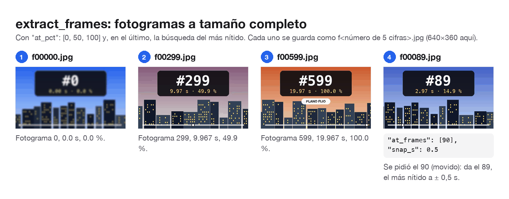

- Usa los mismos `input` y `select` que `make_storyboard`. Sin `select`, saca los 12 más nítidos.
- **Vídeo:** un archivo por fotograma, `f<número de 5 cifras>.jpg` (el fotograma 42 → `f00042.jpg`), a tamaño completo y ya **derecho** (con el giro del móvil aplicado; mide `displayed_size`). Puede ser `"format": "png"`. Con `snap_s`, el fotograma guardado (`frame`) puede ser otro, cercano al pedido: en el ejemplo se pidió el 90 y se guardó el 89, el más nítido a ± 0,5 s.
- **Imágenes:** una copia **byte a byte** de cada imagen elegida, `001_<nombre>`, `002_<nombre>`… en orden, o con su nombre original si `"names": "original"`. Con `"format": "jpg"` o `"png"` se convierten.
- Respuesta: `dir` y, en `files[]`, las mismas claves que `panels[]`, con `file` (la ruta) y `size` (sus píxeles). JSON: [`extraer_pct.json`](formatos/json/extraer_pct.json), [`extraer_snap.json`](formatos/json/extraer_snap.json), [`extraer_fotos.json`](formatos/json/extraer_fotos.json).

## 5. `get_schema` y `schema.json`

- `get_schema {}` devuelve, para cada herramienta, su `description`, su `input_schema` (lo que acepta: tipos, límites, valores por defecto y valores permitidos), su `output_schema` (lo que devuelve) y `examples` (`minimal` y `full`). Con `{"tool": "make_storyboard"}` devuelve solo esa herramienta.
- [`schema.json`](../schema.json) es el mismo documento, guardado en el repositorio. Sale de los modelos de `server.py`, que son la única fuente de verdad. Se regenera con `uv run --script server.py --schema > schema.json`, y las pruebas avisan si no coincide.

## 6. Errores

Los errores en los argumentos llegan todos juntos, cada uno con la ruta del campo. La herramienta no hace nada hasta que se corrigen:

```text
make_storyboard: 5 problems in the arguments:
- input.video: file not found: /Users/ana/no.mp4
- layout.columns: Input should be greater than or equal to 1 (got 0)
- layout.colums: unknown field "colums". Did you mean "columns"? Allowed here: template, columns, rows, page, …
- style.background: "#12" is not a valid colour; use #RRGGBB or #RRGGBBAA (also #RGB, #RGBA) or a CSS colour name such as "white", "black" or "navy"
- style.font: font "Comic Sanz" not found; give the path of a .ttf, .otf or .ttc file or the name of an installed font (similar: Comic Sans MS, Comic Sans MS Bold)
What each field accepts: call get_schema with {"tool": "make_storyboard"}.
```

Otros errores que puedes encontrarte:

| Error | Qué hacer |
|---|---|
| `input: give exactly one of "video", "images" or "folder"` | Deja solo una de las tres |
| `input.images[1]: not an image this server can read: notas.txt` | Quita ese archivo, o usa `folder` con `pattern` |
| `select.at_s: only for video input; with images use …` | Usa el campo que propone |
| `panels: either every panel has a position … or none has` | Pon posición en todas las viñetas o en ninguna |
| `output.format: "mp4" is planned for animated output and not available yet` | Usa `png`, `jpg` o `pdf` |
| `layout.numbering: expected an object like {"format": "5.{n}"}` | Esa sección es un objeto con campos, no un texto suelto |
| `select: every frame was filtered out; lower …` | Afloja los filtros (`min_*`) |
| Una ruta relativa que no existe | El mensaje dice desde qué carpeta se resolvió: usa una ruta absoluta |
